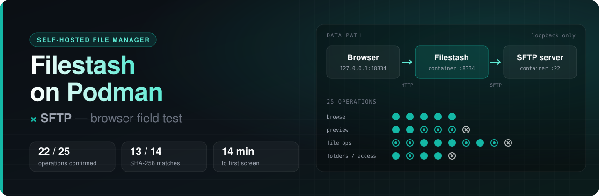
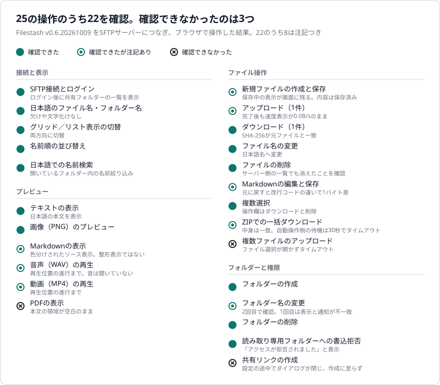
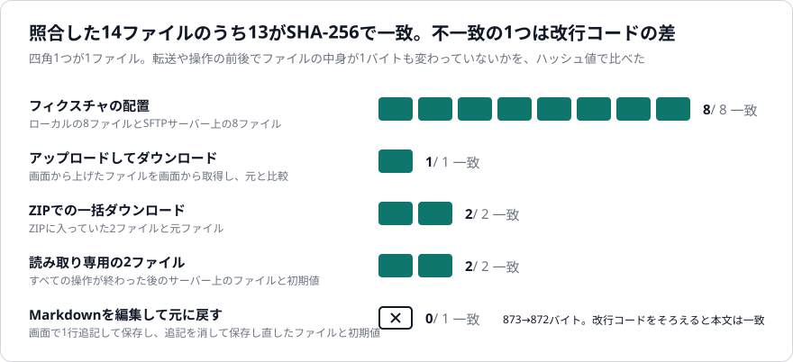
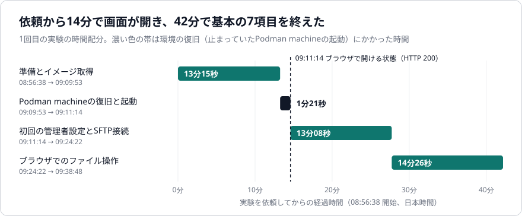

<p align="center">
  
</p>

<h1 align="center">Filestash on Podman × SFTP</h1>

<p align="center">
  <b>SFTPサーバーのファイルは、ブラウザからどこまで安心して触れるのか。</b><br>
  オープンソースのファイル管理ツール Filestash を Windows の Podman で動かし、25の操作を実測した記録と、再現用スクリプト一式。
</p>

<p align="center">
  
  
  
  <br>
  
  
  
  
</p>

<p align="center">
  <a href="ARTICLE.md"><b>解説記事</b></a> ·
  <a href="#結果">結果</a> ·
  <a href="#自分のpcで試す">クイックスタート</a> ·
  <a href="#フォルダ構成">フォルダ構成</a> ·
  <a href="docs/RESULTS-extended.md">実測の結果表</a>
</p>

---

[Filestash](https://github.com/mickael-kerjean/filestash) は、SFTPやS3などの保存先をブラウザのファイル管理画面で扱えるようにするセルフホスト型のツールです。このリポジトリでは、使い捨てのSFTPサーバーと組み合わせてWindowsのPodmanで起動し、日本語のファイル名、プレビュー、転送、権限の効き方を1つずつ確かめました。クラウドで動くAIエージェントと人のあいだでファイルを受け渡す置き場を作るための下調べです。

## 結果

25の操作のうち22を確認できました。確認できなかったのは、PDFの表示、複数ファイルの同時アップロード、共有リンクの作成の3つです（2026-10-10）。

<p align="center">
  
</p>

<p align="center">
  
</p>

<p align="center">
  
</p>

<details>
<summary>グラフの元になった数値</summary>

| 分類 | 操作の数 | 確認できた | うち注記あり |
| --- | ---: | ---: | ---: |
| 接続と表示 | 5 | 5 | 0 |
| プレビュー | 6 | 5 | 3 |
| ファイル操作 | 9 | 8 | 4 |
| フォルダーと権限 | 5 | 4 | 1 |
| 合計 | 25 | 22 | 8 |

| 照合したもの | SHA-256が一致 | 対象 |
| --- | ---: | ---: |
| テスト用ファイルの配置（手元とサーバー） | 8 | 8 |
| 画面からアップロードしてダウンロード | 1 | 1 |
| ZIPでの一括ダウンロード | 2 | 2 |
| 読み取り専用の2ファイル（全操作の後） | 2 | 2 |
| Markdownを編集して元に戻す | 0 | 1 |

| 段階 | 時刻（日本時間） | かかった時間 |
| --- | --- | ---: |
| 準備とイメージ取得 | 08:56:38 → 09:09:53 | 13分15秒 |
| Podman machineの復旧と起動 | 09:09:53 → 09:11:14 | 1分21秒 |
| 初回の管理者設定とSFTP接続 | 09:11:14 → 09:24:22 | 13分08秒 |
| ブラウザでのファイル操作 | 09:24:22 → 09:38:48 | 14分26秒 |

操作ごとの一覧は [results/operations.json](results/operations.json) にあります。

</details>

- 転送や操作の前後でSHA-256を比べた14ファイルのうち13が一致。残る1つは、画面で編集して元に戻したMarkdownの改行コードによる1バイト差。
- SFTPサーバー側で書き込みを禁じたフォルダーは、Filestashの画面からも書けず、「アクセスが拒否されました」と表示された。
- 保存が済んでいるのに保存中の表示が残るなど、画面の表示と実際の状態がずれる箇所があった。

対象は、自分のPCの中（127.0.0.1）だけで開ける使い捨ての環境と、小さなテスト用ファイルです。インターネット越しの利用、大きなファイル、複数人の同時利用、AIエージェントからの接続（SFTP直結やMCPゲートウェイ）は確かめていません。操作の数は、実験時の結果表を操作1つにつき1行へ書き直して数えたものです。詳しい条件は [ARTICLE.md](ARTICLE.md) と [docs/](docs/) にあります。

## 自分のPCで試す

WindowsでPodman machineが起動していれば試せます。

```powershell
git clone https://github.com/Sunwood-ai-labs/filestash-podman-sftp.git
cd filestash-podman-sftp\quickstart
.\start.ps1                                   # → http://127.0.0.1:18334
.\compare-hashes.ps1 -LocalDirectory .\seed   # 手元とサーバーのSHA-256を比べる
.\stop.ps1                                    # 止める（データは残る）
.\cleanup.ps1                                 # コンテナ・ネットワーク・ボリュームを消す
```

起動後はブラウザで次の順に設定します。値は `quickstart\private\connections.json` に作られます（Gitの管理対象外）。

1. `http://127.0.0.1:18334` を開き、管理者パスワードを設定する。
2. 管理画面のストレージ設定でSFTPを選ぶ。
3. ログイン画面で、ホスト名 `filestash-demo-sftp`、ポート `22`、ユーザー名 `qa` とパスワードを入力する。

自分のフォルダーを共有領域に入れるには `.\start.ps1 -SeedDirectory C:\work\share-me`、別のPodman接続やポートを使うには `-Connection`、`-Port`、`-Prefix` を指定します。

| ファイル | 内容 | 確認状況 |
| --- | --- | --- |
| [`quickstart/start.ps1`](quickstart/start.ps1) | 実験と同じイメージ（digest固定）と引数で2つのコンテナを起動 | 名前とポートを変えて通しで実行。HTTP 200まで確認。この起動分でのブラウザの初回設定とSFTPログインは未実施 |
| [`quickstart/compare-hashes.ps1`](quickstart/compare-hashes.ps1) | 手元とSFTPサーバー上のファイルをSHA-256で照合 | 実験のSFTPサーバーにかけ、8ファイル中7一致（記事と同じ結果）を確認 |
| [`quickstart/stop.ps1`](quickstart/stop.ps1) | 起動した2つのコンテナだけを停止 | `-WhatIf` と実停止、再起動を確認 |
| [`quickstart/cleanup.ps1`](quickstart/cleanup.ps1) | 起動時に作ったものだけを削除 | `-WhatIf` と実削除を確認。ほかのコンテナに影響がないことも確認 |
| [`assets/make_charts.py`](assets/make_charts.py) | `results/` からグラフを生成 | 実行してSVGとPNGを出力 |

Dockerでの実行と、Windows以外のOSでは確かめていません。

## フォルダ構成

| フォルダ | 内容 |
| --- | --- |
| `quickstart/` | 自分のPCで起動するためのスクリプト一式 |
| `experiment/` | 実験で実際に動かした起動・停止・削除スクリプトと、テスト用ファイルの元 |
| `results/` | 操作ごとの結果、ハッシュ照合、時刻の記録（`raw/` は実験時のCSVとJSON） |
| `docs/` | 実験時の結果表、画面記録の確認メモ、独立した検収の記録 |
| `assets/` | ヘッダー画像、グラフ、生成スクリプト（`make_charts.py`、`make_header.py`） |

`experiment/` のスクリプトは、実験時のPodman接続名と、同梱していない接続情報ファイル・サンプル画像を前提にしています。そのままでは動かないため、処理内容の参照用です。`docs/` の記録が参照している画面の記録（スクリーンショット36枚）、実行ログ、音声・動画・PDF・画像のテスト用ファイルは、このリポジトリに含めていません。

## 使用したソフトウェア

| 役割 | ソフトウェア |
| --- | --- |
| ファイル管理の画面 | [Filestash](https://github.com/mickael-kerjean/filestash) 画面表示の版 v0.6.20261009、`docker.io/machines/filestash@sha256:db21af2b…7226`（AGPL-3.0） |
| ファイルの保管先 | [atmoz/sftp](https://github.com/atmoz/sftp) alpine版、`docker.io/atmoz/sftp@sha256:7e439fab…813f`（MIT） |
| コンテナの実行 | Podman CLI 5.8.3、machine（WSL）5.8.8、Windows 11 |

各ソフトウェアの利用条件は、それぞれの配布元の記載に従ってください。このリポジトリ自体のライセンスは未設定です。
